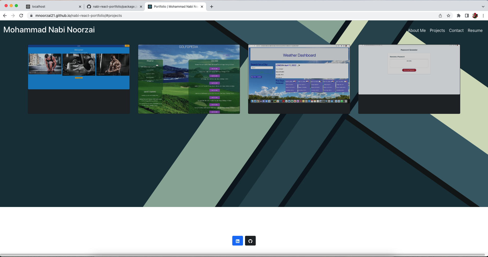

# nabi-react-portfolio-mnn

## Description

This is the official portfolio website of **Mohammad Nabi Noorzai**, showcasing various personal and professional projects, technical skills, and experiences. The portfolio is built using React and highlights the work and achievements of the developer.

## Table of Contents

- [Screenshot](#screenshot)
- [Link](#link)
- [Contact Information](#contact-information)
- [Technologies Used](#technologies-used)
- [Questions](#questions)

## Screenshot

## Link

- **Deployed Portfolio**: [View Portfolio](https://mnoorzai21.github.io/nabi-react-portfolio)
- **GitHub Repository**: [nabi-react-portfolio GitHub](https://github.com/mnoorzai21/nabi-react-portfolio)
  
## Contact Information

- **Email**: [mnoorzai21@gmail.com](mailto:mnoorzai21@gmail.com)
- **LinkedIn**: [linkedin.com/in/mnoorzai21](https://www.linkedin.com/in/mnoorzai21)
  
## Technologies Used

This project was built using the following technologies:

- **React** and **React Bootstrap**: For building the user interface
- **FormSubmit**: Delivers contact-form messages by email, with no backend needed
- **GitHub Actions**: Builds and deploys the site to GitHub Pages on every push to `main`
- **HTML**: For structure and content
- **CSS**: For styling the application
- **JavaScript**: For interactivity and dynamic functionality

## Questions

If you have any questions or inquiries regarding this portfolio, feel free to reach out via the email listed above or open an issue on the [GitHub repository](https://github.com/mnoorzai21/nabi-react-portfolio).

Thank you for visiting my portfolio!
